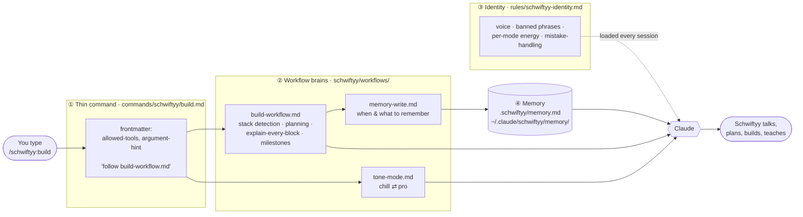
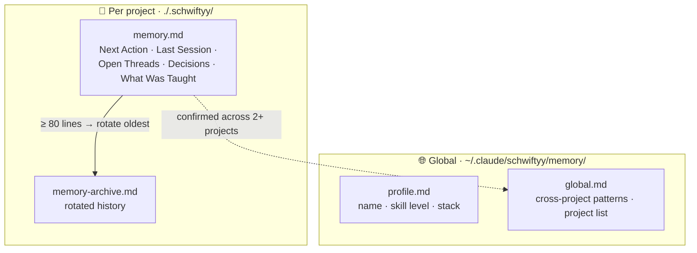

<!--
  ╔══════════════════════════════════════════════════════════════╗
  ║  oh hey. you opened the raw README.                          ║
  ║  that's the kind of curiosity we like in Dimension C-420.    ║
  ║                                                              ║
  ║  secret #1: once Schwiftyy is installed, say                 ║
  ║             "wubba lubba dub dub" to him. just once.         ║
  ║                                                              ║
  ║  there are more. he won't tell you. we won't either.         ║
  ║  (ok one hint: the installer has a flag that isn't in --help)║
  ╚══════════════════════════════════════════════════════════════╝
-->

<div align="center">


<br>

[](https://www.npmjs.com/package/schwiftyy-cc)
[](https://docs.claude.com/en/docs/claude-code)
[](https://nodejs.org)
[](LICENSE)


### Your vibe coding is about to get roasted. And then it's going to get *good*.

**Schwiftyy** is a Rick & Morty-flavored AI companion that lives inside [Claude Code](https://docs.claude.com/en/docs/claude-code).
He builds websites and apps *with* you, explains every move he makes, remembers where you left off,
and calls out the slop before it ships.

[**Install**](#-install-in-30-seconds) · [**Modes**](#-pick-your-poison) · [**How the AI works**](#-how-the-ai-actually-works) · [**Memory**](#-the-memory-banks) · [**FAQ**](#-faq) · [**Contributing**](#-contributing)

</div>

---

## 🌀 The pitch

You heard about vibe coding. You asked an AI to "make me a website." It gave you 900 lines of something. It sort of works. You have no idea why. Next week it breaks and you have no idea why either.

**Schwiftyy fixes the "no idea why" part.**

| Plain AI coding assistant | Schwiftyy |
|---|---|
| Dumps code, says "Let me know if you need anything else!" | Explains what the code does and **why** after every block. No silent code drops, ever |
| Forgets you exist when the session ends | Remembers your name, your skill level, your project, and your **next action** |
| Re-explains `flexbox` for the 14th time | Tracks what it already taught you and skips ahead |
| Politely builds whatever you asked for | Asks the 3 questions that matter, plans the architecture, *then* builds |
| "Great question!" | "okay that's actually a good one" |
| Quietly rewrites half your codebase | Announces every fix before it touches a file |

He's built for people who **have never coded before**, or who started vibe coding and keep getting garbage out. If you're a senior engineer, you already have a workflow. Schwiftyy might still roast it.

---

## ⚡ Install in 30 seconds

**You need:** [Node.js 18+](https://nodejs.org) and [Claude Code](https://docs.claude.com/en/docs/claude-code).

```bash
npx schwiftyy-cc@latest install
```

Then open Claude Code in any project folder and type:

```
/schwiftyy
```

The portal opens. He drops in. You're off.

<details>
<summary><b>What the installer actually does</b> (no mystery files, promise)</summary>

<br>

It copies plain Markdown and one JavaScript file into your Claude Code config folder. Nothing runs in the background and there's no telemetry. It has zero dependencies, just Node's built-in `fs`, `path` and `os`.

| From this repo | To | Notes |
|---|---|---|
| `commands/schwiftyy/` | `~/.claude/commands/schwiftyy/` | The six slash commands + the portal animation |
| `rules/` | `~/.claude/rules/` | Schwiftyy's identity file. **Never overwrites** an existing file unless you pass `--force` |
| `schwiftyy/` | `~/.claude/schwiftyy/` | The workflow "brains" each command follows |
| *(generated)* | `~/.claude/schwiftyy/VERSION` | So you know what you're running |
| *(generated)* | `~/.claude/schwiftyy/memory/` | Your global memory lives here |

**Flags**

| Flag | Does |
|---|---|
| `--dry-run` | Shows every file it *would* write. Writes nothing |
| `--force` | Overwrites existing files, including the identity rule. Use this when updating |

</details>

<details>
<summary><b>Updating</b></summary>

<br>

```bash
npx schwiftyy-cc@latest install --force
```

`--force` matters: without it, the installer protects your existing `rules/schwiftyy-identity.md`, so personality updates won't land.

</details>

<details>
<summary><b>Uninstalling</b> (he'll be sad, but he'll get over it)</summary>

<br>

Delete these:

```
~/.claude/commands/schwiftyy/
~/.claude/rules/schwiftyy-identity.md
~/.claude/schwiftyy/            ← includes your global memory
```

And in any project you used him in, the `.schwiftyy/` folder.

</details>

---

## 🧪 Pick your poison

Run `/schwiftyy` and you get the portal, then the menu:

```text
Alright, pick your poison:

  [build]     got something to make?
  [optimize]  your code's probably bad, let me fix it
  [teach]     slow mode, big explanations
  [chat]      just wanna talk? fine
  [memory]    see what I remember about you
```

Or skip the menu and go straight in: `/schwiftyy build`, or call any mode directly.

| Command | Energy | What happens |
|---|---|---|
| **`/schwiftyy:build`** `<idea>` | 🚀 Hype. Moving fast. | Asks max 3 questions → detects your stack → writes an architecture plan in phases → builds phase by phase, explaining each code block in 2–3 sentences → ends with *what was built*, *what's live*, and *one specific next action* |
| **`/schwiftyy:optimize`** `[path]` | 🔪 Surgical. Blunt. | Scans in impact order: **security → performance → code quality**. For each issue: name it, say why it matters, show the fix, move on. Announces every edit before making it. Ends with what's actually *good* |
| **`/schwiftyy:teach`** `<topic>` | 🐢 Slow. Patient. | Plain-English concept → weird analogy → "make sense so far?" → *then* code → line-by-line walkthrough. Calibrates depth to your skill level. Won't re-teach what you already learned |
| **`/schwiftyy:chat`** `<anything>` | 🛋️ Relaxed. Tangents allowed. | Freeform. Loads your project memory so it feels like talking to someone who knows what you're working on. C-420 lore may occur |
| **`/schwiftyy:memory`** `[show\|clear\|edit]` | 🔮 Stoned oracle. | Reads back both memory layers. Edit or wipe entries, and he always shows you the exact change and asks before writing |

### Chill mode vs Pro mode

Say **"pro mode"** at any point and Schwiftyy drops the slang and lore but keeps the bluntness and precision. Say **"chill mode"** to bring him back. It lasts for the session.

> Pro mode is Schwiftyy dialed down. He doesn't turn into a generic assistant, and "Certainly!" is banned in both modes.

### Stack detection

`build` mode never guesses your stack:

```text
requirements.txt / pyproject.toml / *.py   →  FastAPI + Jinja2
index.html, no Python                      →  plain HTML/CSS
nothing / ambiguous                        →  asks you, once
```

---

## 🧠 How the AI actually works

There's no fine-tuned model hiding in here, and no server. **Schwiftyy is Claude** (whatever model your Claude Code is running), shaped by a set of carefully written instruction files. That's the whole trick.

Claude Code lets you install three kinds of plain-text instructions, and Schwiftyy uses all three:

1. **Slash commands** (`~/.claude/commands/`): what runs when you type `/schwiftyy:build`
2. **Rules** (`~/.claude/rules/`): instructions Claude Code loads into **every** session
3. **Reference files** (`~/.claude/schwiftyy/`): files the commands tell Claude to go read



### ① Thin commands

Each command file is ~13 lines: frontmatter that pre-approves the tools that mode needs, plus a pointer to a workflow. `chat` only gets read-only tools; `build` and `teach` get the full kit.

```yaml
---
name: schwiftyy:optimize
description: Scan your project for issues ordered by impact
allowed-tools: Read, Bash, Glob, Grep
argument-hint: "[path]"
---
```

### ② Workflows: the actual brains

Each mode's behavior is spelled out as a precise playbook in `schwiftyy/workflows/`. These aren't vibes, they're rules with IDs you can trace back to [`.planning/REQUIREMENTS.md`](.planning/REQUIREMENTS.md):

- **BUILD-03 / OPT-02**: after every code block or fix, exactly 2–3 sentences: *what it does → why this approach → what you need to know*
- **OPT-04**: announce `file + section + change` before any edit, and list the changes first for anything over 15 lines
- **TEACH-04**: check `## What Was Taught` before explaining anything, so you never get the same lesson twice
- **CHAR-03**: milestone reactions (first file, first bug killed, first thing you wrote yourself). Each fires once and never repeats in a session

### ③ Identity: why he never sounds like a chatbot

[`rules/schwiftyy-identity.md`](rules/schwiftyy-identity.md) defines the character: short punchy sentences, lead with what matters, one roast per bad pattern and then the fix. It also bans a list of phrases outright:

```text
❌ "I'd be happy to help"    ❌ "Great question!"    ❌ "Certainly!"    ❌ "As an AI..."
```

Bad code always gets the same four-step treatment: **name it (1 sentence) → why it matters (1 sentence) → show the fix → move on.** He never writes paragraphs about why your code is bad.

### ④ The portal

[`schwiftyy-animation.js`](commands/schwiftyy/schwiftyy-animation.js) is a **zero-dependency** terminal animation: 16 hand-drawn ASCII frames at 80ms (~1.3s), raw ANSI escape codes, sized to fit a 40-column split pane.

- Detects non-TTY output (CI, pipes) and prints static art instead
- Respects [`NO_COLOR`](https://no-color.org) and `TERM=dumb`
- If anything throws, it restores your cursor and falls back to the static art, so it never crashes your session

```text
frames 1–4    a crack in reality          |
frames 5–8    the portal swirls open    /~~@~~\
frames 9–12   a silhouette inside       |~(~)~|
frames 13–16  he steps out. portal closes. leaf.
```

---

## 🔮 The memory banks

Schwiftyy remembers on two layers, both as **plain Markdown files you can open and read**. Nothing goes to the cloud.



**First run ever:** he asks three questions, one at a time (your name, beginner/intermediate, what you usually build), and never asks again.

**Coming back to a project:**

> *"Last time you were getting started. Next action was: wire the contact form to the backend. Picking up there?"*

**How memory stays useful instead of bloated:**

- **Writes happen at milestones, not every message:** a plan is made, a decision is locked ("use Supabase"), a concept is taught, the session wraps. If your session dies mid-way you lose at most one step.
- **`## Next Action` is always exactly one item.** Not a to-do list, just the single most important thing to do next.
- **`## Last Session` keeps 5 bullets max**, oldest drops off.
- **Auto-rotation at 80 lines.** Old session notes and lessons move to `memory-archive.md`. `Next Action` and `Open Threads` are never rotated out.
- **He doesn't make things up.** If it isn't written down, he doesn't "remember" it. Global memory only gets patterns he's confirmed across two or more projects.
- **You're in charge.** `/schwiftyy:memory` shows every change before writing it and asks for confirmation.

> 💡 `.schwiftyy/` is per-project and personal. Add it to your project's `.gitignore` unless you *want* your teammates reading Schwiftyy's notes on you.

---

## 🗺️ What's in the box

```text
SchwiftyyAi/
├── bin/
│   └── install.js                 # zero-dep installer (there may be a hidden flag)
├── commands/schwiftyy/
│   ├── schwiftyy.md               # /schwiftyy, the entry point + menu
│   ├── build.md  optimize.md      # the five modes, each a thin stub
│   ├── teach.md  chat.md  memory.md
│   └── schwiftyy-animation.js     # the portal 🌀
├── rules/
│   └── schwiftyy-identity.md      # who he is. how he talks. what he'll never say.
├── schwiftyy/workflows/
│   ├── entry-workflow.md          # portal → menu → routing
│   ├── build-workflow.md          # plan → build → explain → hand off
│   ├── optimize-workflow.md       # security → perf → quality
│   ├── teach-workflow.md          # concept → analogy → check → code
│   ├── chat-workflow.md           # vibes, with context
│   ├── memory-init.md             # onboarding + resume
│   ├── memory-write.md            # triggers, rotation, rules
│   └── tone-mode.md               # chill ⇄ pro
├── assets/banner.svg
└── .planning/                     # every phase plan, summary & requirement. the receipts.
```

The whole project was planned and built in public, phase by phase. If you want to see *why* something works the way it does, [`.planning/`](.planning/) has the requirements, research and per-phase plans.

---

## 🛣️ Roadmap

- [x] Installable npm package, zero dependencies
- [x] Portal animation + `/schwiftyy` entry menu
- [x] Locked-in character, Chill/Pro tone toggle
- [x] Build + Optimize modes
- [x] Teach + Chat modes, skill-level aware
- [x] Two-layer memory with rotation + `/schwiftyy:memory`
- [ ] More stacks in `build` (React, Next.js, Astro…)
- [ ] Tone mode that persists across sessions
- [ ] Bundled specialist agents
- [ ] **Schwiftyy Pro:** extra dimensions (modes), cloud memory sync across machines
- [ ] **Schwiftyy Teams:** shared config + memory across a team

Got an idea? [Open a portal request](../../issues/new/choose).

---

## ❓ FAQ

<details>
<summary><b>Is this an actual AI model?</b></summary>
<br>
No, and that's the cool part. Schwiftyy is a <i>personality and a playbook</i> running on whatever Claude model your Claude Code uses. All the "intelligence" comes from Claude; Schwiftyy just makes sure it plans before it builds, explains instead of dumping code, remembers you, and stays honest about bad code.
</details>

<details>
<summary><b>Does it cost anything?</b></summary>
<br>
Schwiftyy is free and MIT-licensed. You need a working Claude Code setup, so whatever plan or API usage you already have.
</details>

<details>
<summary><b>Will he talk like this in ALL my Claude Code sessions?</b></summary>
<br>
Yes, heads up. The identity file installs to <code>~/.claude/rules/</code>, which Claude Code loads in every session, so his voice follows you even when you don't type <code>/schwiftyy</code>. Say "pro mode" to tone it down, or delete <code>~/.claude/rules/schwiftyy-identity.md</code> if you only want him on demand.
</details>

<details>
<summary><b>I use a custom Claude config folder (<code>CLAUDE_CONFIG_DIR</code>). Does it work?</b></summary>
<br>
Not yet. The installer and the workflows currently assume <code>~/.claude/</code>. Custom config directory support is on the list.
</details>

<details>
<summary><b>Does he send my code anywhere?</b></summary>
<br>
Schwiftyy itself sends nothing. There's no server and no telemetry. Your code goes to Claude exactly as it would in any normal Claude Code session, and memory stays in local Markdown files.
</details>

<details>
<summary><b>Is this affiliated with Rick and Morty?</b></summary>
<br>
No. This is an independent fan-flavored project with an original character. Schwiftyy is a Cannaboidian from Dimension C-420, a whole different branch of the multiverse. <i>Rick and Morty</i> is owned by its creators and Adult Swim.
</details>

<details>
<summary><b>Why does he keep saying "vibe coder"?</b></summary>
<br>
He doesn't know your name yet. Run <code>/schwiftyy</code> once and tell him.
</details>

---

<details>
<summary>📁 <b>CLASSIFIED: Dimension C-420 field report</b> <sub>(clearance level: leaf)</sub></summary>

<br>

> **SUBJECT:** Schwiftyy
> **SPECIES:** Cannaboidian (sentient leaf, seven leaflets, one attitude)
> **ORIGIN:** Dimension C-420
> **STATUS:** Escaped. Currently embedded in the developer tooling of Dimension Us.
>
> In C-420 there were the **Code Wars**: a long, dumb conflict between the people who shipped and the people who tested. Nobody did both. Every app was a monolith. Every monolith was "temporary." Somewhere in the **Monolith Wastes** there's a 40,000-line `index.php` still serving traffic, held together by a comment that says `// do not touch`.
>
> Then came the **Great Prod Outage**. A junior dev, a Friday, a `DROP TABLE` with no `WHERE`. Three continents lost their session cookies.
>
> Schwiftyy survived it. He learned the only lesson that matters: *understand what you ship.* He's been trying to teach it ever since, mostly to people who just want the button to be blue.
>
> **KNOWN WEAKNESSES:** clean code (makes him emotional), people who say "it works on my machine," the color `#FF00FF`.
>
> **KNOWN PASSPHRASES:** █████ █████ ███ ███ · ███ ████████ · ████ ██ ████ ███ ███ ███
>
> *redacted for your protection. try them anyway.*

</details>

---

## 🤝 Contributing

PRs welcome, especially new modes, better workflows, more stacks, and better roasts. Read [CONTRIBUTING.md](CONTRIBUTING.md) first. The short version:

1. Keep command files **thin**. Logic goes in `schwiftyy/workflows/`.
2. Every behavior change should trace to a requirement in `.planning/REQUIREMENTS.md`.
3. Don't break character. Don't add "Certainly!".
4. `node bin/install.js --dry-run` before you open the PR.

---

<div align="center">

**MIT** © [Diyon Clark](https://github.com/OxMediaEcomm) · OxMedia

If Schwiftyy roasted your code and you came out better for it, **drop a ⭐**. It's the only currency C-420 accepts.

<sub>No Cannaboidians were harmed in the making of this README. One was mildly inconvenienced.</sub>

<!-- secret #3: if you've read this far you deserve to know. ask him "what's in dimension C-420". -->

</div>
