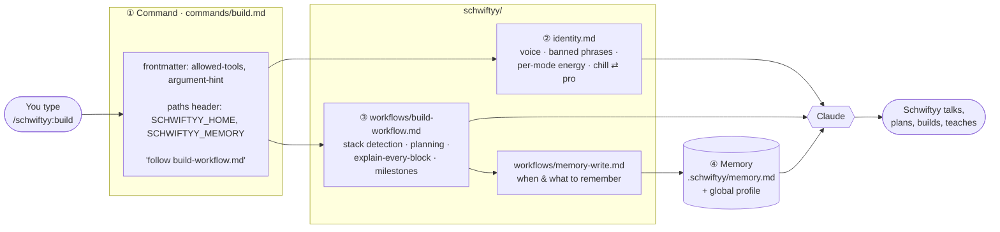

# How the AI actually works

[← back to README](../README.md)

There's no fine-tuned model hiding in here, and no server. **Schwiftyy is Claude** (or whatever model your Claude Code is running), shaped by a set of carefully written Markdown instructions. That's the whole trick.



## ① Commands: thin on purpose

Each file in [`commands/`](../commands) is a short stub with three parts:

1. **Frontmatter**: which tools that mode may use without asking (`allowed-tools`) and the hint shown in autocomplete.
2. **The paths header**: tells Claude where Schwiftyy's files and memory live on *this* machine:

   ```markdown
   - `$SCHWIFTYY_HOME` = `${CLAUDE_PLUGIN_ROOT}/schwiftyy`
   - `$SCHWIFTYY_MEMORY` = `${CLAUDE_PLUGIN_DATA}/memory`
   ```

   As a plugin, Claude Code fills in `${CLAUDE_PLUGIN_ROOT}` and `${CLAUDE_PLUGIN_DATA}` itself. Through npm, [the installer](../installer/install.js) fills them in when it copies the files. Either way, the same source files work on every machine, with no hardcoded paths. [`scripts/check.js`](../scripts/check.js) fails CI if one ever sneaks in.
3. **A pointer**: "follow `$SCHWIFTYY_HOME/workflows/build-workflow.md`".

| Command | Tools | Why |
|---|---|---|
| `portal` | Bash, Read, Write, Edit, Glob, Grep | Plays the portal, sets up memory |
| `build`, `teach` | Bash, Read, Write, Edit, Glob, Grep | They write code with you |
| `optimize` | Bash, Read, Write, Edit, Glob, Grep | Applies fixes (announces each first) |
| `chat` | Read, Write, Edit, Glob, Grep | Writes only to its own memory file |
| `memory` | Bash, Read, Write, Edit | Reads and edits memory, with your confirmation |

## ② Identity: why he never sounds like a chatbot

[`schwiftyy/identity.md`](../schwiftyy/identity.md) is the character: short punchy sentences, lead with what matters, one roast per bad pattern and then the fix. It also bans a list of phrases outright:

```text
❌ "I'd be happy to help"    ❌ "Great question!"    ❌ "Certainly!"    ❌ "As an AI..."
```

Bad code always gets the same four steps: **name it (1 sentence) → why it matters (1 sentence) → show the fix → move on.**

Every command tells Claude to read it first. It only loads when you call Schwiftyy, so your other Claude Code sessions stay normal. (Before 0.2.0 it was installed as a global rule that took over *every* session. The installer removes that now.)

The same file generates the [Ollama Modelfile](../ollama/Modelfile), so local Schwiftyy has the exact same personality.

## ③ Workflows: the actual brains

[`schwiftyy/workflows/`](../schwiftyy/workflows) holds one playbook per mode. They aren't vibes; they're rules with IDs you can trace back to [the requirements](development/planning/REQUIREMENTS.md):

| Rule | What it enforces |
|---|---|
| **BUILD-02** | Detect the stack before planning: Python → FastAPI + Jinja2, `index.html` → plain HTML/CSS, otherwise ask once |
| **BUILD-03 / OPT-02** | After every code block or fix, exactly 2–3 sentences: *what it does → why this approach → what you need to know* |
| **OPT-01/03** | Scan in impact order: security → performance → code quality |
| **OPT-04** | Announce `file + section + change` before any edit; list changes first for anything over 15 lines |
| **TEACH-01/03** | Plain English → analogy → "make sense?" → *then* code → line-by-line |
| **TEACH-04** | Check `What Was Taught` first; never re-teach a concept |
| **CHAR-03** | Milestone reactions (first file, first bug killed, first thing you wrote yourself), each once per session |
| **MEM-11** | Add `.schwiftyy/` to your `.gitignore` so his notes on you don't get committed |

## ④ Memory

See [memory.md](memory.md).

## ⑤ The portal

[`schwiftyy/portal.js`](../schwiftyy/portal.js) is a **zero-dependency** terminal animation: 16 hand-drawn ASCII frames at 80 ms (~1.3 s), raw ANSI escape codes, sized to fit a 40-column split pane.

- Detects non-TTY output (CI, pipes, Claude Code's Bash tool) and prints static art instead
- Respects [`NO_COLOR`](https://no-color.org) and `TERM=dumb`
- If anything throws, restores your cursor and falls back to the static art; it never crashes your session

```text
frames 1–4    a crack in reality          |
frames 5–8    the portal swirls open    /~~@~~\
frames 9–12   a silhouette inside       |~(~)~|
frames 13–16  he steps out. portal closes. leaf.
```

## Repo map

```text
SchwiftyyAi/
├── .claude-plugin/
│   ├── plugin.json            # makes this repo a Claude Code plugin
│   └── marketplace.json       # …and its own marketplace
├── commands/                  # /schwiftyy:portal, :build, :optimize, :teach, :chat, :memory
├── schwiftyy/
│   ├── identity.md            # who he is (single source of truth)
│   ├── portal.js              # the portal 🌀
│   └── workflows/             # one playbook per mode + memory rules
├── installer/install.js       # npm channel: zero deps, CLAUDE_CONFIG_DIR aware
├── ollama/Modelfile           # GENERATED from identity.md
├── scripts/
│   ├── check.js               # CI + prepublish guardrails
│   └── build-modelfile.js
├── docs/                      # you are here
│   └── development/planning/  # every phase plan, summary & requirement. the receipts.
└── .github/workflows/         # CI on every PR · npm publish on release
```
