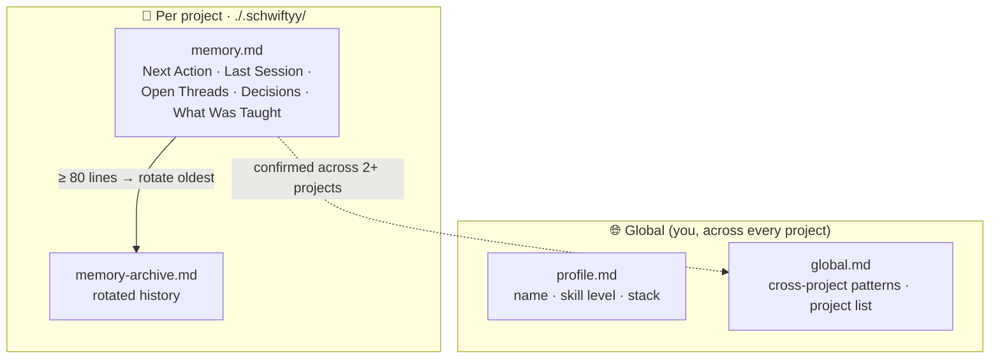

# The memory banks

[← back to README](../README.md)

Schwiftyy remembers on two layers, both as **plain Markdown files you can open and read**. Nothing goes to the cloud.

## Where the files live

| Layer | Where |
|---|---|
| Global | `~/.schwiftyy/memory/`, the same for both install methods and every Claude Code config |
| Project | `<your project>/.schwiftyy/` |

Schwiftyy can read and write these two folders without asking you every time. A small hook approves exactly these paths and nothing else ([how it works](how-it-works.md)). Uninstalling keeps your memory unless you ask to purge it.

## How it behaves

**First run ever:** he asks three questions, one at a time (your name, beginner/intermediate, what you usually build), and never asks again.

**First run in a project:** he creates `.schwiftyy/memory.md` and, if it's a git repo, offers to add `.schwiftyy/` to your `.gitignore`.

**Coming back:**

> *"Last time you were getting started. Next action was: wire the contact form to the backend. Picking up there?"*

## Rules that keep memory useful instead of bloated

- **Writes happen at milestones, not every message:** a plan is made, a decision is locked ("use Supabase"), a concept is taught, the session wraps. If your session dies mid-way you lose at most one step.
- **`## Next Action` is always exactly one item.** Not a to-do list, just the single most important thing to do next.
- **`## Last Session` keeps 5 bullets max**, oldest drops off.
- **Auto-rotation at 80 lines.** Old session notes and lessons move to `memory-archive.md`. `Next Action` and `Open Threads` are never rotated out.
- **He doesn't make things up.** If it isn't written down, he doesn't "remember" it. Global memory only gets patterns he's confirmed across two or more projects.
- **You're in charge.** `/schwiftyy:memory` shows every change before writing it and asks for confirmation. `/schwiftyy:memory clear` wipes the project layer; the global layer needs you to say "clear my profile."

The exact rules live in [`memory-init.md`](../schwiftyy/workflows/memory-init.md) and [`memory-write.md`](../schwiftyy/workflows/memory-write.md).
